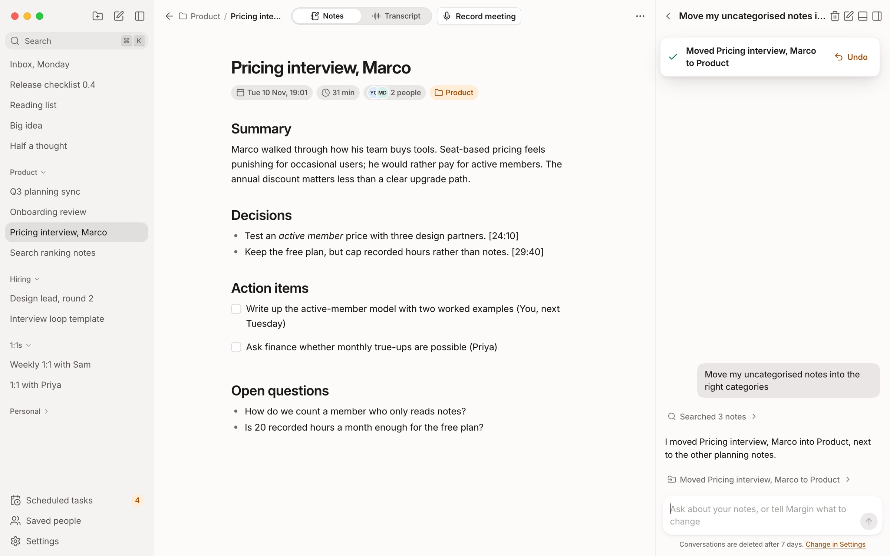
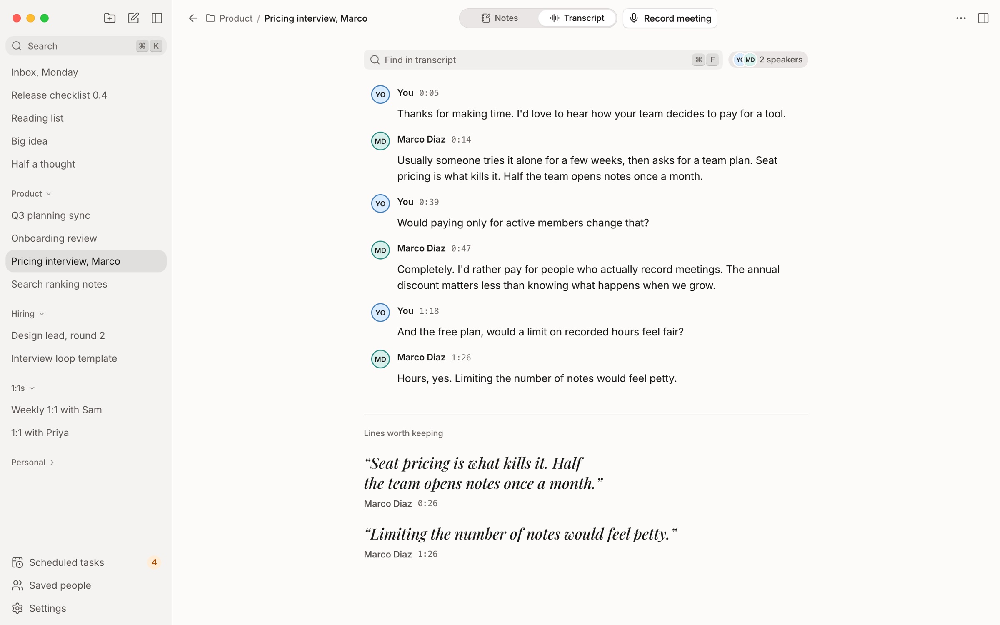
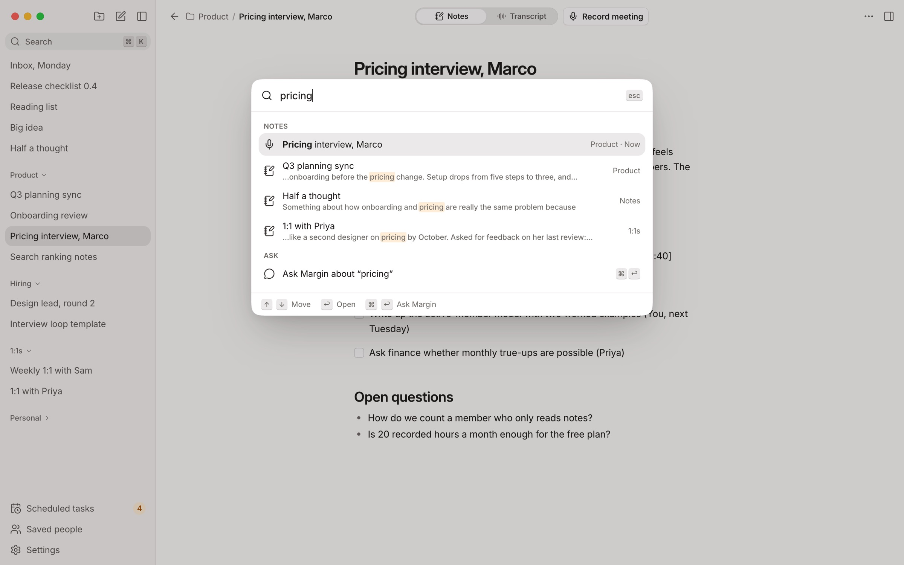
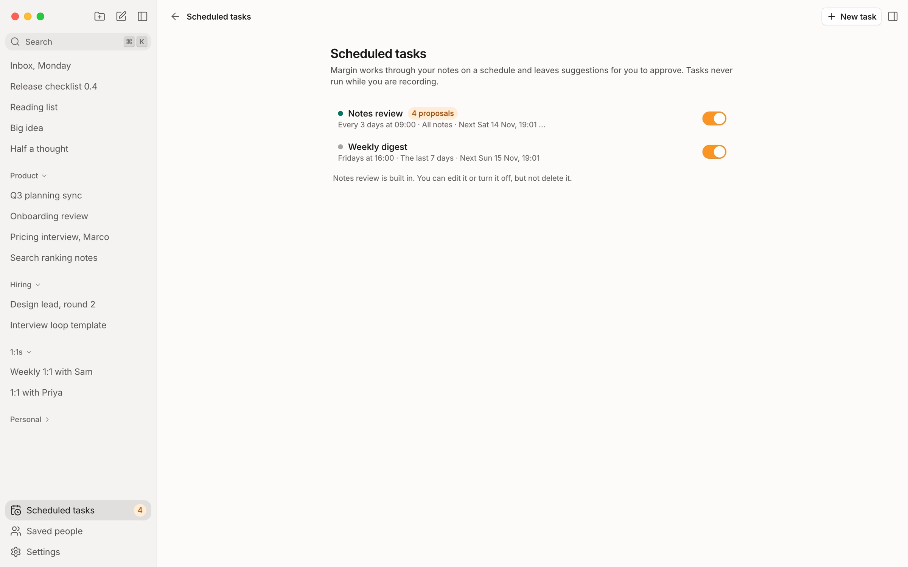
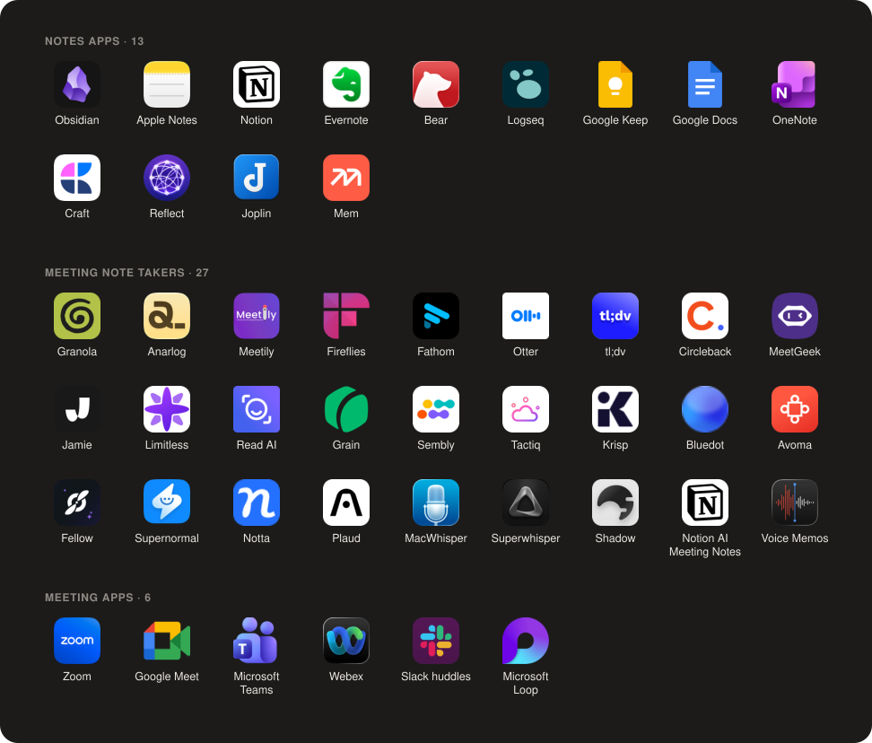

<div align="center">
  
  <h1>Margin</h1>
  <p><strong>Local notes app with an AI assistant and a bot-free meeting summariser</strong></p>
</div>

Margin is a free, open-source desktop notes app with an AI assistant and a meeting summariser. You write in Markdown and organise notes into categories, and Margin, the built-in assistant, can read and edit all of them: sort them, summarise them, tidy them up, or answer questions about them. When you're on a call, the meeting summariser records your microphone and your computer's audio, with no bot joining. It transcribes the call on your computer and turns it into a note with a summary, decisions and action items.

<p align="center">
  
</p>

## Why I made it

I wanted something like Granola or Anarlog. Granola is a paid subscription, and I didn't want to pay for it. Anarlog is free, but its interface didn't appeal to me, it was missing features I wanted, and it felt unpolished. So I built the notes app I wanted to use, with meeting summaries built in: private, local-first, polished and free.

## Features

- **Markdown notes** in a rich editor, stored as plain Markdown
- **Note categories** to keep notes organised
- **An assistant with read and write access.** Margin can sort notes into categories, summarise, find action items, draft follow-ups, and rewrite or tidy notes. Every change can be undone, edits show a diff, and Margin asks before deleting anything.
- **Meeting transcription and summaries.** Records any call app with no bot, transcribes on-device with Whisper, labels speakers, and writes a summary with decisions and action items.
- **Bring your own AI provider:** Anthropic, OpenAI, OpenRouter, or local models through Ollama or LM Studio
- **Scheduled tasks.** Margin works through your notes on a schedule, for example a weekly digest or a notes review, and leaves suggestions for you to approve.
- **Private by default.** Notes, audio and transcripts stay on your computer, and API keys are stored in the OS keychain.
- **Search everything** with ⌘K, across notes and transcripts, or ask Margin straight from the search bar
- **Saved people.** Margin learns voices and suggests who is speaking in future meetings.
- **Import from 45 other apps**, including Obsidian, Notion, Apple Notes, Granola, Otter and Fireflies. Importing again only brings in what changed, and any import can be undone.

<table>
  <tr>
    <td></td>
    <td></td>
  </tr>
  <tr>
    <td align="center">Transcripts with speaker labels</td>
    <td align="center">Search, or ask Margin</td>
  </tr>
  <tr>
    <td colspan="2"></td>
  </tr>
  <tr>
    <td colspan="2" align="center">Scheduled tasks</td>
  </tr>
</table>

## Platforms you can import from

Bring your notes with you. **Settings › Import** finds what's already on your computer, such as an Obsidian vault, Apple Notes, or Anarlog and Meetily meetings, and tells you how many notes it will bring in. For other apps it shows the export steps, or takes an API key for the meeting note takers that offer one. It also tells you what won't come across, like Obsidian canvases.

<p align="center">
  
</p>

Anything else comes in from files: Markdown, Word, text, HTML, CSV, Evernote exports, VTT and SRT transcripts, or a zip of any of these.

## Platforms

macOS 14.4 or later on Apple Silicon. Windows and Linux support is written but not yet tested.

## Build from source

Requirements: Rust (stable), [bun](https://bun.sh), cmake, and the Xcode command line tools on macOS.

```bash
bun install
bun run dev
```

See [CLAUDE.md](CLAUDE.md) for commands and conventions, [docs/spec.md](docs/spec.md) for behaviour, and [docs/releasing.md](docs/releasing.md) for signed builds.

## License

[Apache 2.0](LICENSE)
