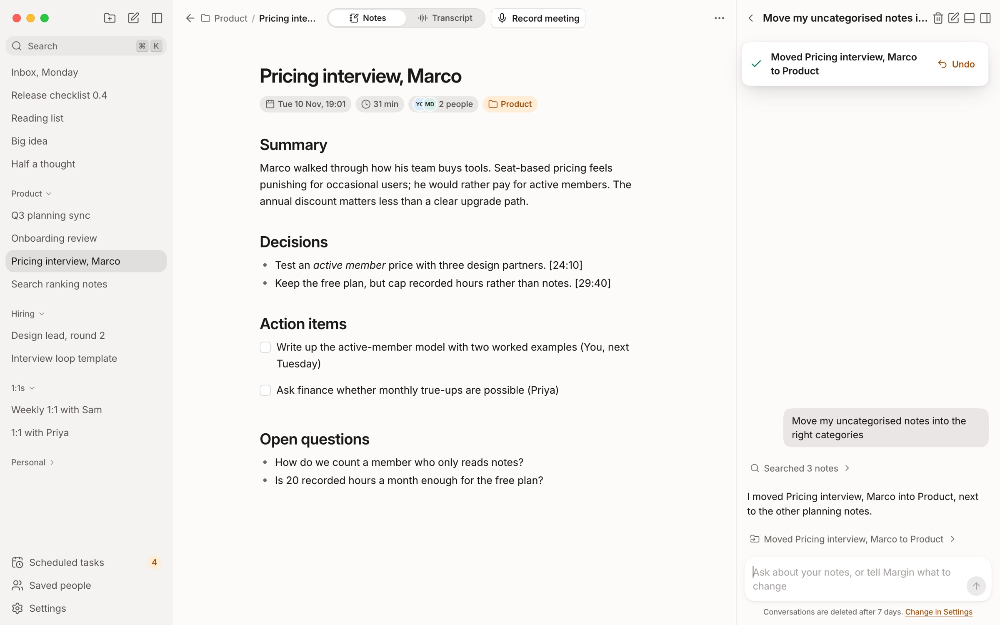
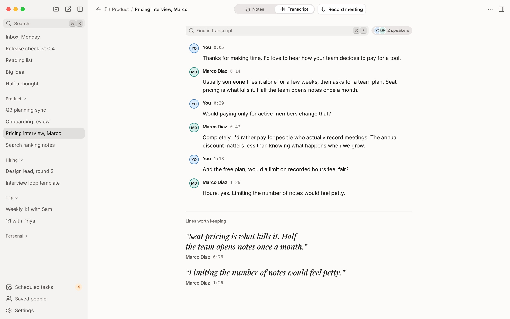
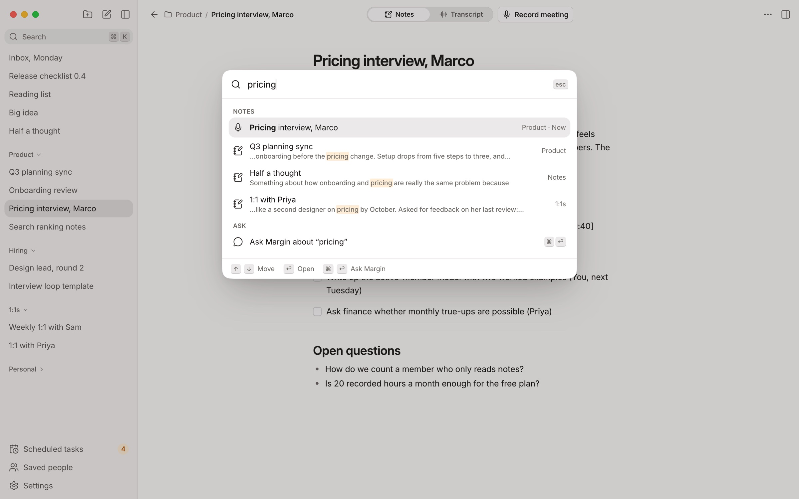
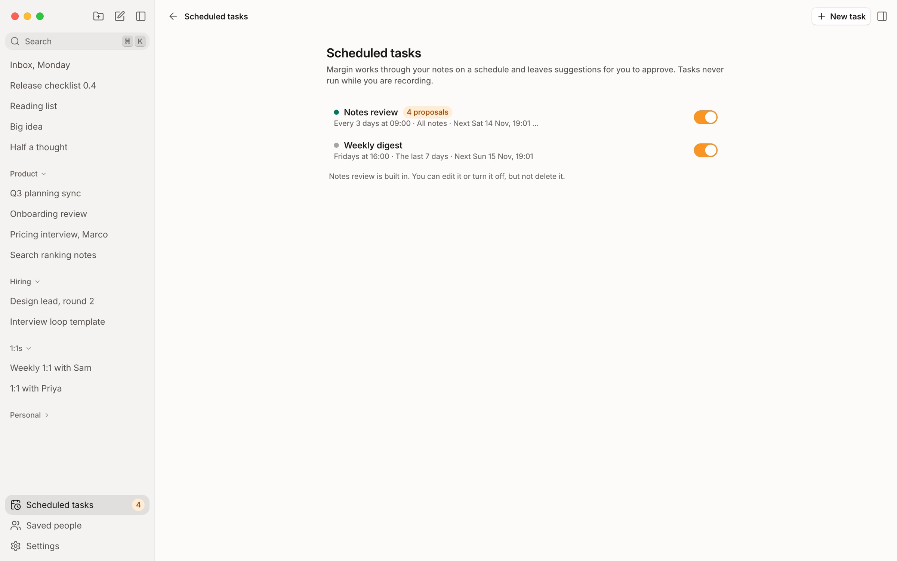
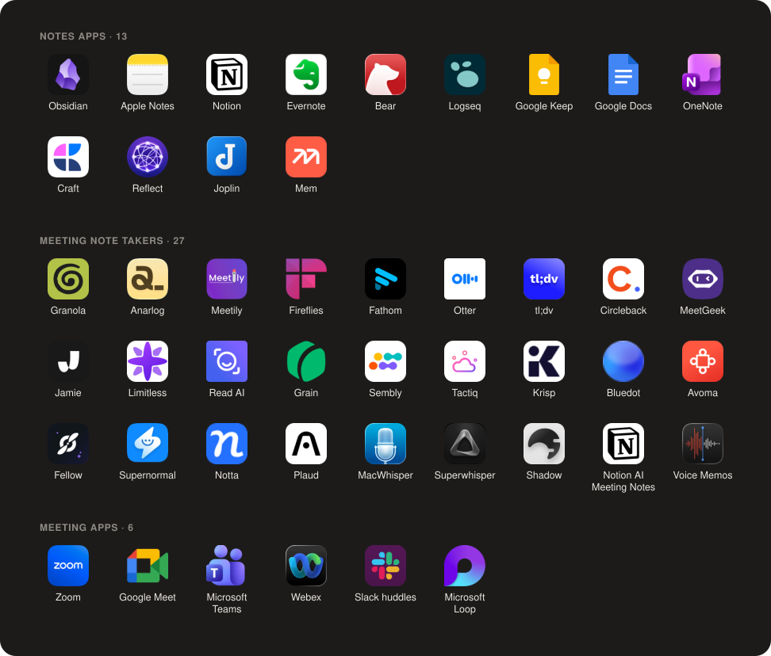

<div align="center">
  
  <h1>Margin</h1>
  <h3>Hit record. Get the notes.<br>No bot on the call. No cloud. No subscription.</h3>
  <p>Margin listens to your meetings on your own computer and turns them into clean Markdown notes, with an assistant beside them that can actually edit them.</p>

  <p>
    <a href="https://github.com/Benzo-Fury/margin/releases/latest"></a>
  </p>
  <p>
    <a href="https://github.com/Benzo-Fury/margin/releases"></a>
    <a href="LICENSE"></a>
    
    <a href="https://github.com/Benzo-Fury/margin/stargazers"></a>
  </p>
</div>

<p align="center">
  
</p>

## Three steps. That's the whole manual.

1. **Open Margin.** It downloads its speech model once, then works offline.
2. **Join any call.** Zoom, Meet, Teams, Slack, WhatsApp, anything with sound. Margin notices the call and asks if you want to record. Or press `⌘⇧R`.
3. **Hang up.** Your note is already there: a summary, the decisions, who owes what, and the full transcript with speakers labelled.

Type your own notes during the call if you like. Margin keeps them and weaves them into the summary.

## Then just ask

Margin, the assistant, can read and edit every note you have. Not just chat about them.

> "What did I promise Priya this week?"
>
> "Draft the follow-up email from this morning's call."
>
> "Move every Acme note into Clients and merge the duplicates."

It works like a careful colleague. New things land with an undo button, edits show you a diff before they apply, and it asks before it deletes anything.

## Why Margin

- **No bot joins your call.** Margin records your microphone and your computer's sound, so nobody sees a "Notetaker has joined" tile and it works with every call app.
- **Everything stays on your Mac.** Audio is transcribed on-device with Whisper. Notes, audio and transcripts never leave your computer unless you choose a cloud engine.
- **Your notes are plain Markdown.** No lock-in. They even open cleanly in Obsidian, `[[links]]` and all.
- **An assistant with hands.** It sorts, summarises, rewrites and tidies, and every change can be undone.
- **Bring any model.** Anthropic, OpenAI or OpenRouter with your own key, or fully offline with Ollama or LM Studio.
- **It works while you don't.** Scheduled tasks, like a Friday digest or a weekly notes review, leave suggestions for you to approve.
- **Free and open source.** Apache 2.0. No account, no trial, no seat pricing.

## How it compares

|  | **Margin** | Cloud notepads | Bot note takers |
| --- | :---: | :---: | :---: |
| Bot joins your call | No | No | Yes |
| Audio processed on your computer | **Yes** | No | No |
| Works fully offline | **Yes** | No | No |
| Notes stored as Markdown files you own | **Yes** | Export only | Export only |
| Assistant can edit your notes, with undo | **Yes** | No | No |
| Pick your own AI model, including local | **Yes** | No | No |
| Price | **Free** | Subscription | Subscription |
| Open source | **Yes** | No | No |

<sub>Cloud notepads means apps like Granola; bot note takers means apps like Otter and Fireflies. Based on their default setups as of November 2026.</sub>

## What runs where

| Step | Where it happens |
| --- | --- |
| Recording | Your computer |
| Transcription and speaker labels | Your computer (cloud engines are opt-in) |
| Notes, transcripts, search | Your computer, in a local database |
| Summaries and the assistant | The AI provider you pick, or your computer with Ollama or LM Studio |
| API keys | Your OS keychain |

## A closer look

<table>
  <tr>
    <td></td>
    <td></td>
  </tr>
  <tr>
    <td align="center"><b>Transcripts with speakers.</b> Margin learns voices and suggests who's talking next time.</td>
    <td align="center"><b>Search everything with <code>⌘K</code>.</b> Notes and transcripts, or ask Margin straight from the bar.</td>
  </tr>
  <tr>
    <td colspan="2"></td>
  </tr>
  <tr>
    <td colspan="2" align="center"><b>Scheduled tasks.</b> Margin tidies up on a schedule and asks before anything changes.</td>
  </tr>
</table>

## Bring everything with you

Switching takes a minute. **Settings › Import** finds what's already on your computer, like an Obsidian vault or Apple Notes, and tells you how many notes it will bring in. Import again later and only the changes come across. Any import can be undone.

<p align="center">
  
</p>

45 apps, plus Markdown, Word, HTML, CSV, VTT and SRT files, or a zip of any of them.

## Questions

<details>
<summary><b>Is it really free?</b></summary>
<br>
Yes. Margin is open source under Apache 2.0, with no account and no paid tier. If you use a cloud AI provider you pay them directly for what you use, or you can run a local model through Ollama or LM Studio and pay nothing.
</details>

<details>
<summary><b>Which call apps does it work with?</b></summary>
<br>
All of them. Margin records your microphone and your computer's sound rather than plugging into any one app, so Zoom, Google Meet, Teams, Slack huddles, WhatsApp and FaceTime all work the same way.
</details>

<details>
<summary><b>Will the other people on the call know?</b></summary>
<br>
Nothing appears in the call, so tell people you're recording. Many places require their consent by law.
</details>

<details>
<summary><b>Can it run with no internet at all?</b></summary>
<br>
Yes. Transcription is always local by default. Point the assistant at Ollama or LM Studio and nothing leaves your computer.
</details>

<details>
<summary><b>What about Windows and Linux?</b></summary>
<br>
Support is written but not tested yet. Watch the repo for the first release, or build from source and tell us how it goes.
</details>

## Build from source

<details>
<summary>For contributors</summary>
<br>

You'll need Rust (stable), [bun](https://bun.sh), cmake, and the Xcode command line tools on macOS.

```bash
bun install
bun run dev
```

[CLAUDE.md](CLAUDE.md) has the commands and conventions, [docs/spec.md](docs/spec.md) the behaviour, [docs/architecture.md](docs/architecture.md) how it fits together, and [docs/releasing.md](docs/releasing.md) how to make signed builds.
</details>

## Why I built it

I wanted a meeting notepad that was private, polished and free, and couldn't find one that was all three. So I built it. If you've come from a paid note taker, welcome.

<p align="center"><sub>Apache 2.0 · Made for people who'd rather be in the meeting than writing it up.</sub></p>
